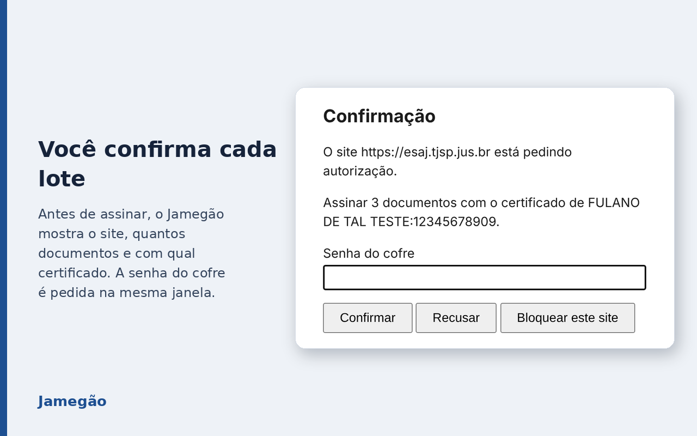

# Jamegão

**[Português](#português)** · **[English](#english)**

---

## Português

O Jamegão é uma extensão para Firefox e para os navegadores Chromium (Chrome, Edge, Brave) que permite **entrar e assinar no e-SAJ e no PJe com certificado digital A1** (o arquivo PFX), direto no navegador, **sem instalar programa algum no computador**. No e-SAJ, ela ocupa o lugar das extensões oficiais de assinatura, que dependem de um programa nativo instalado à parte e que não existe para todos os sistemas: não há versão para Mac com processador Apple (M1 em diante), por exemplo. No PJe, se você ligar, ela ocupa o lugar do programa assinador que o PJe manda instalar (veja [PJe](#pje)). Com o Jamegão, basta o navegador.

*Jamegão* é como se diz, na fala popular, a assinatura de alguém.

O Jamegão é um projeto independente, sem vínculo com os fornecedores do e-SAJ, das extensões oficiais e do programa assinador do PJe, nem com o CNJ ou os tribunais.

| Certificado | Atende? |
|---|---|
| A1 (arquivo `.pfx` ou `.p12`) | **sim** |
| A3 em token ou cartão | não: use o [Tessera](https://github.com/pedrohqb/tessera), projeto irmão, com as extensões oficiais ou o programa do PJe |
| Certificado em nuvem (SerproID, RemoteID, Bird ID) | não |



---

### Onde funciona

**Sistemas:** Linux, Windows, macOS (Intel e Apple), ChromeOS, Android (pelo Firefox) e até OpenBSD, onde o login no e-SAJ já foi testado. O que importa é o navegador.

| Navegador | Versão mínima | Como instalar |
|---|---|---|
| Firefox | 140 | [Firefox Add-ons](https://addons.mozilla.org/firefox/addon/jamegao/) ([abaixo](#firefox)) |
| Firefox para Android | 142 | [Firefox Add-ons](https://addons.mozilla.org/android/addon/jamegao/), pelo menu **⋮ → Extensões** do Firefox |
| Google Chrome, Microsoft Edge, Brave, Chromium | 121 | [Chrome Web Store](https://chromewebstore.google.com/detail/pkmhmpmgojhgogcklacckpideochcggj) ([abaixo](#chrome-edge-brave-e-chromium)) |

**Tribunais:** o Jamegão atua nos portais e-SAJ abaixo e, se você ligar, no PJe (veja [PJe](#pje)). No eproc e no Projudi, que já aceitam o certificado direto no navegador, ele não é necessário.

| Tribunal | Endereço | Situação |
|---|---|---|
| TJSP | `esaj.tjsp.jus.br` | petição assinada e protocolada no Firefox; login testado também no Brave |
| TJAL | `www2.tjal.jus.br` | login e assinatura testados na versão de teste |
| TJMS | `esaj.tjms.jus.br` | incluído, ainda não testado |
| TJAC | `esaj.tjac.jus.br` | incluído, ainda não testado |
| TJCE | `esaj.tjce.jus.br` | incluído (peticionamento de plantão), ainda não testado |
| TJBA | `esaj.tjba.jus.br` | incluído, ainda não testado |

Se você usar um desses que ainda não foram testados, conte como foi numa [issue](https://github.com/pedrohqb/jamegao/issues).

---

### Instalação

#### Firefox

1. Abra a página do Jamegão em **[Firefox Add-ons](https://addons.mozilla.org/firefox/addon/jamegao/)** e clique em **Adicionar ao Firefox**. A extensão se atualiza sozinha.
2. Em `about:addons` → Jamegão → **Permissões**, confira se o acesso aos sites do e-SAJ está ligado. O Firefox às vezes deixa desligado.

Quem instalou uma versão anterior pelo arquivo `.xpi` da [página de versões](https://github.com/pedrohqb/jamegao/releases) não precisa fazer nada: o Firefox passa para a versão da loja sozinho, e o cofre e os certificados continuam. O arquivo `.xpi` continua disponível lá, para quem preferir instalar à mão (arrastando-o para o Firefox).

#### Android

No celular ou tablet, só o **Firefox** aceita extensões (o Chrome do Android, não). Instale pelo Firefox: menu **⋮ → Extensões**, procure **Jamegão** (ou abra a [página dele](https://addons.mozilla.org/android/addon/jamegao/)) e toque em **Adicionar**. Para importar, deixe o arquivo PFX na pasta **Download** do aparelho.

No Android, a confirmação abre numa aba em vez de janela: ela fecha sozinha depois da resposta e devolve você ao e-SAJ, e fechá-la vale como recusar. Se o portal do e-SAJ não mostrar a entrada por certificado, use **⋮ → Site para computador**.

#### Chrome, Edge, Brave e Chromium

Instale pela **[Chrome Web Store](https://chromewebstore.google.com/detail/pkmhmpmgojhgogcklacckpideochcggj)**, com o botão **Usar no Chrome**. A mesma loja serve ao Edge, ao Brave e ao Chromium (no Edge, aceite "Permitir extensões de outras lojas" quando ele perguntar). A extensão se atualiza sozinha.

Se preferir instalar à mão, sem a loja:

1. Baixe o arquivo `jamegao-<versão>-chromium.zip` da [página de versões](https://github.com/pedrohqb/jamegao/releases) e descompacte-o **numa pasta fixa**, que você não vai apagar nem mover.
2. Abra `chrome://extensions` (no Edge, `edge://extensions`; no Brave, `brave://extensions`) e ligue o **Modo do desenvolvedor**.
3. Clique em **Carregar sem compactação** e escolha a pasta.

Para atualizar a instalação manual, substitua os arquivos **na mesma pasta** e clique em recarregar (a seta circular) no cartão do Jamegão. Carregar de outra pasta cria outra extensão, vazia.

#### Antes de usar: as extensões oficiais

O Jamegão é para quem **não** usa as extensões oficiais de assinatura. Se uma delas estiver ativa no navegador, o Jamegão percebe e se desliga na página, e quem responde ao e-SAJ é a oficial. As duas não funcionam juntas: o e-SAJ fica com a primeira resposta que chega, e a oficial responde na hora "certificado não encontrado" para o A1 do Jamegão.

Para usar o Jamegão, **desative ou remova as extensões oficiais** nesse perfil do navegador e recarregue a página do e-SAJ. Se você precisa delas para um token A3 ou para um certificado em nuvem, use um perfil do navegador para cada caso.

No PJe é diferente: o programa instalado pode continuar no computador, e a janela do Jamegão deixa escolher, a cada pedido, quem atende (veja [PJe](#pje)).

---

### Uso

#### 1. Importar o certificado (uma vez)

A página de importação abre sozinha na instalação; depois, fica no ícone do Jamegão → **Importar certificado**.

1. Escolha o arquivo `.pfx` ou `.p12` (ou arraste-o para a página) e digite a senha dele.
2. Crie a **senha do cofre**, com pelo menos 8 caracteres. É ela que você vai digitar no dia a dia; a senha do PFX não é guardada.

A chave privada fica cifrada com a senha do cofre, no perfil do navegador. **Guarde o arquivo PFX**: ele é a sua cópia de segurança. Desinstalar a extensão apaga o cofre.

#### 2. Entrar no e-SAJ

Abra o e-SAJ e escolha a entrada por certificado digital, como faria com a extensão oficial.

- **Na primeira vez em cada tribunal**, uma janela do Jamegão pergunta se aquele site pode ver os seus certificados. Responda **Confirmar**.
- **A cada login**, a janela mostra "Assinar 1 documento com o certificado de [seu nome]" e, se o cofre estiver travado, pede a senha do cofre na mesma janela.

#### 3. Peticionar

Ao protocolar, o e-SAJ pede a assinatura de todos os arquivos de uma vez. A janela mostra **quantos documentos** serão assinados e com qual certificado, e uma confirmação vale para o lote inteiro.

#### A janela de confirmação

| Botão | O que faz |
|---|---|
| **Confirmar** | autoriza o que está descrito na janela |
| **Recusar** | o e-SAJ recebe "cancelado pelo usuário"; o site fica 15 segundos sem poder abrir outra janela |
| **Bloquear este site** | recusa e bloqueia o site; para desfazer, use **Desbloquear** no ícone |

Sem resposta em 2 minutos, o pedido vence e a janela fecha.

#### O ícone do Jamegão

- **Cofre:** se está travado ou destravado, e o botão **Travar agora**. O cofre trava sozinho depois de 30 minutos sem uso e quando o navegador fecha.
- **Certificados:** os importados, com a validade. Avisa quando faltam menos de 30 dias para vencer.
- **Sites:** cada site que já pediu acesso, com as opções **Permitido**, **Bloquear** e **Desbloquear**. Um aviso aparece quando o Jamegão encontrou uma extensão oficial e se desligou em algum e-SAJ.
- **PJe:** a caixa **Usar também no PJe** e, se o PJe pediu uma operação que o Jamegão ainda não faz, o aviso com a operação e o site.
- **Esqueci a senha:** sem a senha do cofre não há como recuperar a chave; o botão apaga cofre, certificados e sites, e você importa o PFX de novo.

Senhas erradas seguidas fazem o Jamegão esperar antes da próxima tentativa (até 5 minutos).

---

### PJe

Desde a versão 0.3.0, o Jamegão também entra e assina no PJe, no lugar do programa assinador que o PJe manda instalar. **Ele vem desligado:** quem não liga continua exatamente como antes, com o programa instalado, se tiver.

#### 1. Ligar (uma vez)

1. No ícone do Jamegão, marque **Usar também no PJe**. O mesmo botão aparece no fim da importação do certificado.
2. O navegador pede permissão para acessar os sites `https://*.jus.br/*`. Aceite. É só desta vez.
3. Recarregue as páginas do PJe que estiverem abertas: só as carregadas depois de ligar têm o Jamegão.

No Firefox, o pedido de permissão às vezes aparece atrás da janela do ícone. Feche a janela do ícone e aceite o pedido: o PJe fica ligado do mesmo jeito. Para desligar, desmarque a caixa.

Por que uma permissão tão ampla: o PJe está em dezenas de endereços, todos em `.jus.br`, sem padrão de nome. Ela só é pedida a quem liga o PJe, para que a atualização não desative a extensão de quem usa só o e-SAJ. Nesses sites o Jamegão fica parado e só age quando a página chama o programa assinador do PJe.

#### 2. Importar o certificado de novo

O PJe exige a cadeia completa do certificado (o seu e os das autoridades certificadoras), que o Jamegão só passou a guardar na versão 0.3.0. Os certificados importados antes aparecem no ícone com o aviso **"Importe de novo para usar no PJe."** Importe o mesmo arquivo PFX de novo (ícone → **Importar certificado**): ele substitui o registro antigo, e no e-SAJ nada muda. Importe antes de usar o PJe: com um certificado importado antes da 0.3.0, a janela do Jamegão no PJe só mostra o aviso de reimportação e os botões **Usar o programa instalado** e **Fechar**; nada é assinado.

Se o seu PFX não trouxer as autoridades certificadoras, o ícone avisa: o PJe pode recusá-lo, e é preciso pedir à certificadora o arquivo PFX com a cadeia completa.

#### 3. Entrar e assinar

Entre no PJe por certificado, como faria com o programa.

- **Na primeira vez em cada site** (o login do PJe fica num endereço próprio, como `sso.cloud.pje.jus.br`, e o tribunal em outro), a janela do Jamegão pergunta se aquele site pode ver os seus certificados.
- **A cada login**, a janela mostra "Entrar no PJe de [site] com o certificado de [seu nome]".
- **A cada lote de documentos**, a janela mostra "Assinar N documentos no PJe de [site]...", sempre, com a quantidade, e uma confirmação vale para o lote inteiro.
- **Com mais de um certificado**, a janela mostra a lista para escolher, já marcado o último usado naquele site.

Quem envia as assinaturas ao servidor do PJe é a própria página do PJe, como faria com o programa. O Jamegão continua sem fazer conexão de rede alguma.

#### Com o programa do PJe instalado

O programa pode continuar instalado. Na janela do Jamegão no PJe, há dois caminhos para ele:

| Botão | O que faz |
|---|---|
| **Usar o programa instalado** | só este pedido vai para o programa instalado, e o Jamegão não assina. Serve a quem usa o A1 no Jamegão e um token ou certificado em nuvem pelo programa |
| **Bloquear este site** | recusa este pedido (com a pausa de 15 segundos) e, a partir do próximo pedido, aquele site passa ao programa instalado de vez; para desfazer, use **Desbloquear** no ícone |

O mesmo acontece quando não há certificado importado no Jamegão: o pedido segue para o programa. O Jamegão não verifica se o programa está rodando; se não estiver, o PJe mostra o próprio aviso de que o assinador não está disponível.

#### O que ainda não faz

O Jamegão faz o login e a assinatura de documentos, as duas operações vistas no PJe até agora. Se o PJe pedir outra, o Jamegão não assina e deixa o pedido seguir para o programa instalado, se houver, e o ícone mostra "O PJe pediu uma operação que o Jamegão ainda não faz: [operação] em [site]." Conte numa [issue](https://github.com/pedrohqb/jamegao/issues), com a operação e o site, para que ela entre numa próxima versão.

#### Onde foi testado

Login e assinatura de documentos foram testados no PJe do TJMA (1º grau), no Brave, com certificado A1 real, numa versão de teste anterior à 0.3.0. A 0.3.0 ainda não foi testada num PJe real, nem no Firefox ou no Android. Os demais tribunais da lista do PJe mantida pelo CNJ devem funcionar do mesmo jeito, mas ainda não foram testados. Se você usar um deles, conte como foi numa [issue](https://github.com/pedrohqb/jamegao/issues).

---

### Segurança e privacidade

- A chave privada só existe decifrada dentro da extensão, durante a assinatura. Ela nunca vai para a página do tribunal.
- Nenhum site recebe dados do certificado sem a sua autorização, e nenhuma assinatura é feita sem o cofre destravado e a sua confirmação na janela do Jamegão.
- A extensão não tem servidor, não faz conexões de rede e não coleta dados. Só o site do e-SAJ ou do PJe que você autorizou recebe, quando pede, os dados públicos do certificado e as assinaturas que você confirmou. No PJe, quem as envia ao servidor do tribunal é a própria página.
- Permissões pedidas ao navegador: `storage`, `alarms` e `scripting` (esta, para pôr o Jamegão nas páginas do PJe quando você liga), acesso aos endereços da tabela de tribunais e, só se você ligar o PJe, aos sites `https://*.jus.br/*`.

Detalhes na [política de privacidade](PRIVACIDADE.md).

---

### Perguntas frequentes

**O e-SAJ diz que o componente de assinatura não está instalado.** Confira se há algum certificado importado (o Jamegão só se apresenta ao e-SAJ quando há). No Firefox, confira também a permissão de acesso aos sites (passo 3 da instalação). Depois, recarregue a página.

**Com a extensão oficial ativa, nada acontece ou dá erro.** É de propósito: com a oficial presente, o Jamegão se desliga. Desative a oficial e recarregue a página.

**Reinstalei a extensão e sumiu tudo.** É o navegador: ao remover uma extensão, ele apaga os dados dela. Importe o PFX de novo. Para atualizar sem perder nada, veja a instalação de cada navegador.

**Posso usar no mesmo navegador o Jamegão para o A1 e a extensão oficial para o token?** Não ao mesmo tempo. Use perfis separados do navegador: um com o Jamegão, outro com a oficial.

**Funciona no PJe, no eproc ou no Projudi?** No PJe, sim, desde a versão 0.3.0, se você ligar (veja [PJe](#pje)). O eproc e o Projudi aceitam o certificado direto no navegador e não precisam do Jamegão.

**Liguei o PJe e a página continua chamando o programa.** Recarregue a página do PJe. Depois, no ícone, confira se a caixa **Usar também no PJe** está marcada, se há certificado importado sem o aviso "Importe de novo para usar no PJe." e se o site não está bloqueado.

---

### A fazer

- **Testar a assinatura de petição no Chromium** (no Firefox, já funcionou no TJSP).
- **Testar TJMS, TJAC, TJCE e TJBA.**
- **Testar o PJe no Firefox e em outros tribunais** (Justiça do Trabalho, Justiça Federal e outros estaduais).
- **Outras operações do PJe**, uma a uma, quando aparecerem num tribunal real.

---

### Desenvolvimento

O código não tem etapa de compilação: a pasta `ext/` é a extensão, com o mesmo código para Firefox e Chromium (Manifest V3). A única biblioteca de terceiros é a [node-forge](https://github.com/digitalbazaar/forge), usada só para ler o PFX na importação. Ela vai sem nenhuma alteração, como a Mozilla exige das bibliotecas de terceiros, e um teste de unidade confere o arquivo, byte a byte, contra o da node-forge instalada.

```
npm run preparar     # baixa as cópias do SDK do e-SAJ usadas nos testes e instala as dependências
npm run unit         # testes de unidade
BROWSER=chrome npm run e2e   # ponta a ponta no Chrome
BROWSER=firefox FIREFOX_BIN=/caminho/do/firefox npm run e2e   # ponta a ponta no Firefox
npm run empacotar    # gera dist/jamegao-<versão>.zip, o mesmo para as duas lojas
```

Para testar uma alteração sem empacotar: no Chromium, "Carregar sem compactação" com a pasta `ext/`; no Firefox, `about:debugging#/runtime/this-firefox` → "Carregar extensão temporária…" → `ext/manifest.json`.

- [Guia de testes](docs/TESTES.md): o roteiro manual no e-SAJ e a suíte automática.
- [Pendências](docs/PENDENCIAS.md): o que foi testado, o que falta e o que vai para a próxima versão.
- [Desenho](docs/superpowers/specs/2026-11-21-jamegao-design.md): decisões, protocolo e segurança; o do PJe, [à parte](docs/superpowers/specs/2026-11-24-pje-design.md).
- [Envio às lojas](docs/lojas/roteiro-de-envio.md): textos, capturas e passo a passo.

---

### Suporte e licença

- **Suporte:** abra uma [issue](https://github.com/pedrohqb/jamegao/issues) ou peça ajuda no grupo oficial no [Telegram](https://t.me/advogados_linux).
- **Licença:** GPL-3.0. A node-forge é distribuída sob a licença própria, em `ext/vendor/forge-LICENSE`.

---

## English

Jamegão is a Firefox and Chromium (Chrome, Edge, Brave) extension that lets Brazilian lawyers **log in and sign on e-SAJ and PJe court systems with an A1 digital certificate** (a PFX file), right in the browser, **with no native software installed**. On e-SAJ it stands in for the official signing extensions, which need a separately installed native component that is not available on every system (there is none for Apple Silicon Macs, for instance); on PJe, once turned on, it stands in for the signer program PJe asks you to install. *Jamegão* is Brazilian slang for someone's signature.

It is an independent project, not affiliated with the vendors of e-SAJ, of the official extensions or of the PJe signer program, nor with the CNJ or the courts. A3 tokens and smart cards are not supported; for those, see the sister project [Tessera](https://github.com/pedrohqb/tessera).

**Works on** Linux, Windows, macOS, ChromeOS, Android (Firefox 142+) and even OpenBSD (e-SAJ login tested), with Firefox 140+ or Chromium-based browsers 121+, on the e-SAJ portals of TJSP, TJAL, TJMS, TJAC, TJCE and TJBA (tested so far on TJSP and TJAL) and, since 0.3.0, on PJe (login and document signing tested on TJMA, first instance, with Brave, on a test build earlier than 0.3.0).

**Install.** Firefox: install from [Firefox Add-ons](https://addons.mozilla.org/firefox/addon/jamegao/); then check in `about:addons` → Jamegão → Permissions that site access is on. Chromium browsers (Chrome, Edge, Brave): install from the [Chrome Web Store](https://chromewebstore.google.com/detail/pkmhmpmgojhgogcklacckpideochcggj). Jamegão is for people who do not use the official signing extensions: if one is active on the page, Jamegão turns itself off there, so disable them in that browser profile.

**Use.** Import your PFX once and set a vault password (8+ characters); the private key is stored encrypted in the browser profile. On e-SAJ, choose certificate login as usual. The first time on each court site, Jamegão asks whether the site may see your certificates; every signature, single or batch, needs your confirmation in Jamegão's own window, which shows how many documents will be signed. The vault locks after 30 minutes idle and when the browser closes.

**PJe.** Off by default. Turn it on with **Usar também no PJe** in the toolbar popup (or at the end of the import); the browser asks once for access to `https://*.jus.br/*`; reload any open PJe pages. Certificates imported before 0.3.0 must be imported again, because PJe needs the full certificate chain. Login and document signing are supported; any other operation PJe asks for is passed on to the installed signer program, if there is one, and listed in the popup so you can report it. In the PJe confirmation window, **Usar o programa instalado** sends that one request to the installed program, and **Bloquear este site** refuses the current request and hands that site over to it from the next request on.

**Privacy.** No server, no network connections, no data collection. Only the e-SAJ or PJe site you authorized receives, on request, your certificate's public data and the signatures you confirmed; on PJe, the page itself sends them to its own server. See the [privacy policy](PRIVACIDADE.md) (in Portuguese).

**Development, support and license.** No build step; see [Desenvolvimento](#desenvolvimento) for the commands. Issues are welcome at [GitHub](https://github.com/pedrohqb/jamegao/issues). License: GPL-3.0.
